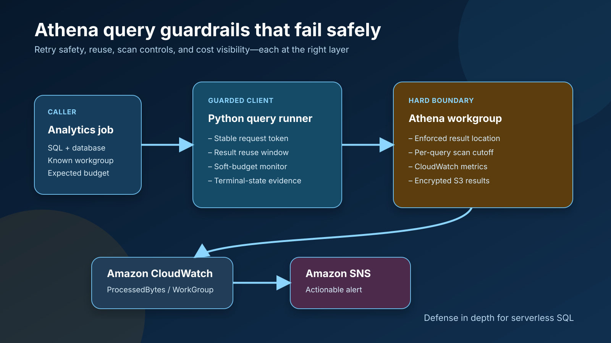

# Stop Expensive Athena Queries Before They Surprise You

Amazon Athena makes the first query wonderfully easy. Put data in Amazon S3,
define a table, and run SQL. The operational question arrives later: how do we
keep a retry, a dashboard refresh, or a missing partition filter from scanning
far more data than intended?

The answer is not one perfect setting. It is a small set of controls at
different layers.

In this walkthrough, I build a guarded query path with four properties:

1. retries do not accidentally start duplicate executions;
2. eligible repeated queries can reuse a recent result;
3. the client requests cancellation after crossing a soft budget;
4. the Athena workgroup enforces a hard per-query limit and publishes usage
   metrics.

The complete example uses Python, AWS CloudFormation, Amazon CloudWatch, and
Amazon SNS. It is safe by default: the command-line tool prints its request
plan unless the operator explicitly adds `--execute`.

The complete tested source is available on
[GitHub](https://github.com/prabhacloud/athena-query-guardrails).



## Why one guardrail is not enough

These controls solve different failure modes.

A client request token handles retry ambiguity. Imagine that a worker submits a
query, loses its network connection, and cannot tell whether Athena received
the request. A stable `ClientRequestToken` lets the worker retry the same
logical request without intentionally creating another execution.

Result reuse addresses repetition. If an eligible query is submitted again
within the configured age window, Athena can return a previously calculated
result instead of scanning the source data again. This is useful for repeated
dashboard or notebook queries, but the reuse window is also a freshness
decision. I would not silently apply a long window to data that must reflect
the latest write.

A client-side scan budget improves responsiveness and evidence. The runner
polls `GetQueryExecution`, records `DataScannedInBytes`, and asks Athena to stop
when the observed value crosses a threshold.

That client threshold is still only a soft boundary. Polling is not
instantaneous, a process can crash, and scan statistics can advance between
polls. The authoritative boundary belongs in the Athena workgroup through
`BytesScannedCutoffPerQuery`.

Finally, a workgroup-wide CloudWatch alarm catches a different class of
problem: many individually acceptable queries whose combined usage is
unexpected. A one-query cutoff cannot detect that pattern.

## Layer 1: make retries idempotent

The demo builds the request token from the pieces that define one logical
submission, including a caller-provided request key:

```python
identity = {
    "query": query.strip(),
    "catalog": config.catalog,
    "database": config.database,
    "workgroup": config.workgroup,
    "output_location": config.output_location,
    "execution_parameters": list(execution_parameters),
    "request_key": request_key,
}
canonical = json.dumps(identity, sort_keys=True, separators=(",", ":"))
token = hashlib.sha256(canonical.encode("utf-8")).hexdigest()
```

The SHA-256 digest is deterministic and fits Athena's token length
requirements. The same submission produces the same token; changing the
request key, database, workgroup, output location, or parameters produces a
different one.

This detail matters. A new random UUID for every recovery attempt does not make
a cross-process retry idempotent because every retry receives a new identity.
At the other extreme, hashing only the SQL context forever would make a later
intentional rerun look like the original submission, preventing Athena from
evaluating result reuse. A scheduler run ID, workflow execution ID, or another
durable per-submission key provides the right scope.

The repository tests all three cases:

- equivalent requests receive the same token;
- intentional runs with different request keys receive different tokens;
- a changed database receives a different token.

## Layer 2: reuse results deliberately

The request also includes Athena's result reuse configuration:

```python
"ResultReuseConfiguration": {
    "ResultReuseByAgeConfiguration": {
        "Enabled": True,
        "MaxAgeInMinutes": 30,
    }
}
```

Thirty minutes is an example, not a universal recommendation. Choose a window
from the data product's freshness contract:

- operational data may need reuse disabled or a very short window;
- a daily curated dataset may tolerate a longer window;
- scheduled pipelines should make the choice explicit rather than inherit an
  accidental default.

The runner surfaces `ReusedPreviousResult` in its final outcome. That turns
reuse from an invisible optimization into evidence that can be logged and
measured.

There is an important security benefit to keeping this feature server-side:
Athena evaluates whether a previous result is eligible for reuse, including
the relevant query context and access conditions. The client asks for reuse;
it does not copy or substitute cached objects itself.

## Layer 3: stop when the observed scan crosses a soft budget

While a query is queued or running, the example inspects the execution
statistics:

```python
if (
    state not in TERMINAL_STATES
    and data_scanned > config.soft_budget_bytes
    and not cancellation_requested
):
    client.stop_query_execution(QueryExecutionId=query_execution_id)
    cancellation_requested = True
```

The `cancellation_requested` flag prevents a tight polling loop from sending
the same stop request repeatedly. The runner then continues polling until it
sees a terminal state. This distinction is valuable in production telemetry:
"we requested cancellation" and "Athena reports the query as cancelled" are
not the same event.

I use this layer for an application-specific expectation. For example, a job
that normally scans 80 MiB might use a 256 MiB soft budget, while the shared
workgroup has a 1 GiB hard cutoff. The earlier signal belongs to the job; the
hard safety limit belongs to the platform.

Do not present this loop as a cost guarantee. It is best-effort cancellation.
The workgroup cutoff is the enforceable control.

## Layer 4: enforce the boundary in an Athena workgroup

The CloudFormation template creates an Athena workgroup with these settings:

```json
{
  "BytesScannedCutoffPerQuery": {
    "Ref": "BytesScannedCutoffPerQuery"
  },
  "EnforceWorkGroupConfiguration": true,
  "PublishCloudWatchMetricsEnabled": true,
  "ResultConfiguration": {
    "EncryptionConfiguration": {
      "EncryptionOption": "SSE_S3"
    },
    "OutputLocation": {
      "Fn::Sub": "s3://${AthenaResultsBucket}/results/"
    }
  }
}
```

`EnforceWorkGroupConfiguration` is easy to overlook. Without enforcement, a
client can supply its own result configuration. With enforcement enabled, the
workgroup's configuration wins, giving the platform a consistent encrypted
result location.

The per-query cutoff is parameterized and defaults to 1 GiB in the example.
Treat that value as a starting point. A useful limit is based on expected table
layout, partition size, query class, and workload. Setting it below the normal
scan size merely converts cost surprises into reliability incidents.

The S3 results bucket has:

- S3-managed server-side encryption;
- all four S3 Block Public Access settings;
- a policy denying non-TLS requests;
- a lifecycle rule for result expiration;
- `DeletionPolicy: Retain`.

Retention makes stack deletion safer, but it also means cleanup is explicit.
The README calls this out so a temporary demonstration does not quietly leave
objects behind.

## Detect aggregate usage with CloudWatch

The workgroup publishes Athena metrics to CloudWatch. The template creates an
alarm on `AWS/Athena` `ProcessedBytes`, filtered by the `WorkGroup` dimension:

```json
{
  "Namespace": "AWS/Athena",
  "MetricName": "ProcessedBytes",
  "Statistic": "Sum",
  "Period": 3600,
  "EvaluationPeriods": 1,
  "ComparisonOperator": "GreaterThanThreshold"
}
```

The default threshold is 10 GiB in one hour. Again, the number is illustrative.
A practical threshold comes from a baseline:

1. measure normal hourly processed bytes for the workgroup;
2. separate scheduled peaks from interactive use;
3. choose a threshold that is unusual and actionable;
4. route the SNS notification to an owner who can investigate.

An alert without an owner is only another metric.

For a mature platform, I would add several workgroups rather than one global
workgroup: for example, interactive exploration, dashboards, and scheduled
transformations. Each workload can then have an appropriate cutoff, alarm, and
result retention policy.

## Test without spending on AWS

The most useful parts of the query runner can be tested without credentials.
The repository uses a fake Athena client to verify:

- the exact `StartQueryExecution` request;
- deterministic token behavior;
- result reuse evidence;
- a single stop request after the soft threshold;
- timeout behavior when a query never reaches a terminal state.

The CloudFormation template also has structural tests that check encryption,
public access blocking, workgroup enforcement, metric dimensions, and the
absence of account-specific identifiers.

I also ran the repository's Python client against a disposable stack in
`us-east-2`. The first query over a three-row CSV scanned 75 bytes. Repeating
the same SQL with a new submission key returned a reused result with zero bytes
scanned. Repeating the original submission key returned the original execution
ID, confirming retry idempotency. The temporary table, workgroup, stack, and
versioned S3 bucket were removed after validation.

Run everything with:

```bash
python3 -m unittest discover -s tests -v
```

Preview a request without contacting AWS:

```bash
python3 src/athena_guardrails.py \
  --query-file examples/daily_orders.sql \
  --workgroup analytics-guarded \
  --database analytics \
  --output-location s3://replace-me/athena-results/ \
  --soft-budget-mb 256 \
  --request-key daily-orders-2026-11-08
```

Only an explicit `--execute` changes the behavior from planning to execution.
Infrastructure deployment is separate and the README starts with a
non-executing CloudFormation change set.

## The operational takeaway

Athena cost control is strongest when it is also reliability engineering.

Use the client to express the intent of one job: stable retries, an appropriate
reuse window, and a soft budget. Use the workgroup to enforce the platform
boundary: result configuration, a hard scan cutoff, and metrics. Use
CloudWatch to detect aggregate behavior that no individual query limit can
see.

None of these controls excuses poor data layout. Partition pruning, columnar
formats, compression, and compact files still do the heavy lifting. Guardrails
provide the safer failure mode when a query does not behave as expected.

That is the pattern I want in a serverless analytics platform: optimize the
normal path, but design the abnormal path deliberately.

## References

- AWS Athena API Reference, `StartQueryExecution`:
  https://docs.aws.amazon.com/athena/latest/APIReference/API_StartQueryExecution.html
- AWS Athena API Reference, `GetQueryExecution`:
  https://docs.aws.amazon.com/athena/latest/APIReference/API_GetQueryExecution.html
- Athena User Guide, result reuse:
  https://docs.aws.amazon.com/athena/latest/ug/reusing-query-results.html
- Athena User Guide, workgroup data usage controls:
  https://docs.aws.amazon.com/athena/latest/ug/workgroups-setting-control-limits-cloudwatch.html
- Athena User Guide, workgroup metrics:
  https://docs.aws.amazon.com/athena/latest/ug/query-metrics-viewing.html
- AWS CloudFormation, `AWS::Athena::WorkGroup`:
  https://docs.aws.amazon.com/AWSCloudFormation/latest/TemplateReference/aws-resource-athena-workgroup.html
- AWS CloudFormation, `AWS::Athena::WorkGroup WorkGroupConfiguration`:
  https://docs.aws.amazon.com/AWSCloudFormation/latest/TemplateReference/aws-properties-athena-workgroup-workgroupconfiguration.html

